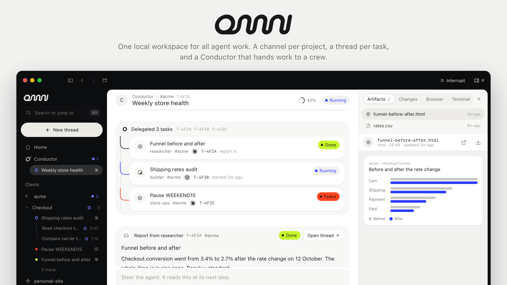

<p align="center">
  <picture>
    <source media="(prefers-color-scheme: dark)" srcset="docs/assets/hero/hero-dark.png">
    
  </picture>
</p>

# Omni OS

One local workspace for all agent work. Channels per client or project, a thread per task, a Conductor that hands work to a crew, and automations on a schedule or on GitHub PR events. It replaces hopping between Claude Desktop, Cursor cloud agents and a separate conductor bot.

One Node server runs everything (threads, harnesses, database, secrets, automations). The clients use its `/api` and show the same channels and threads:

| Client | What | Where |
| --- | --- | --- |
| Desktop app | Electron app for macOS and Linux: the Web UI in its own window, with the server inside, plus menus, notifications and the Quick Prompt. No checkout or Node needed ([ADR 0010](docs/adr/0010-desktop-app-is-electron.md)) | `apps/desktop/` |
| Web UI | React app, in any browser and on your phone over Tailscale | `apps/web/` |

## What does it cost?

Nothing extra. Omni runs each thread through the official CLI of the harness you pick, signed in to the plan you already pay for. It does not need an API key, except for the optional Hermes and Cursor Cloud harnesses.

## Harnesses

> [!IMPORTANT]
> Install and sign in to at least one harness before your first thread. [Auto](docs/user/harnesses.md#auto) is the default for new threads and picks the harness, model and effort from the first prompt, unless you set a default or pick one. Some features (published artifacts, mods) work only with Claude Code.
>
> - Claude Code (Claude plan): `npm install -g @anthropic-ai/claude-code`, then run `claude` and `/login`
> - Codex (ChatGPT plan): `npm install -g @openai/codex && codex login`. Optional. When you ask the Conductor to review a pull request Claude wrote, the review runs on Codex
> - Cursor Agent (Cursor plan): `curl https://cursor.com/install -fsS | bash && cursor-agent login`
> - Hermes (Anthropic API, on your own Linux server): no CLI on this machine. See [Harnesses](docs/user/harnesses.md#hermes-remote)
> - Cursor Cloud (Cursor plan, a Cursor cloud agent on Cursor's machines): the secret `CURSOR_API_KEY`. See [Harnesses](docs/user/harnesses.md#cursor-cloud)

`npm run setup` and the first-run screens check which ones are installed and signed in, and print the fix for each one that is not.

## Quick start

The desktop app needs no checkout: install the DMG or AppImage ([Install](docs/user/install.md#the-desktop-app)). Running from a checkout or building the app needs Node 24+ and Rust ([What you need](docs/user/install.md#what-you-need)). Either way, sign in to `gh`. Secrets go to the Keychain on a Mac and a 0600 file on Linux.

**Let an agent do it.** Open Claude Code, Codex or Cursor in an empty terminal and paste this. Swap `<you>` for your GitHub owner, or point it at an existing clone.

```text
Clone github.com/<you>/omni-os to ~/omni-os (skip if it is already there), then build and open its
desktop app. Follow the "Agent instructions" in docs/user/install.md step by step, run every check
it lists, and stop and tell me if a check fails.
```

**Or by hand:**

```bash
git clone https://github.com/<you>/omni-os.git ~/omni-os
cd ~/omni-os
npm install --include=dev
npm run build:desktop     # Desktop app on a Mac: builds, installs to ~/Applications/Omni.app and opens it
# or the Web UI in a browser:
npm run setup             # who you are and where your work lives; Enter takes each default
npm run dev               # server on :4747, UI on http://localhost:4748
```

The desktop app's Linux AppImage and other builds: [apps/desktop/README.md](apps/desktop/README.md). Coming from the old SwiftUI app or Linux launcher: [Install](docs/user/install.md#coming-from-the-swiftui-app-or-the-linux-launcher).

Forking it for yourself? Read [FORKING.md](FORKING.md): everything personal lives in `data/`, so upstream updates merge cleanly.

> [!WARNING]
> Omni is early and built for one person's daily use on their own Mac. Expect rough edges.
>
> - Threads run with `bypassPermissions`, since nobody can answer a prompt headless. Isolation is a git worktree plus a browser profile, not a VM.
> - Every API request needs the install's token from `api-token` in the data dir (a checkout's `data/`, or the desktop app's data folder in [Install](docs/user/install.md)). A browser pairs once to get it. Keep the server on loopback and reach it remotely only over your tailnet. See [Remote access and security](docs/user/remote-access.md).

## What you get

- **Channels** per client or project, each with its own icon and avatar background, default harness, model and effort, a design system file for the agent, and facts like the repo, plus the Shopify store and Portal slug with the Shopify add-on (Settings > Extras)
- **Threads** per task, dated, full-text searchable and resumable. Running and Pinned list threads from every channel; the sidebar Inbox (Activity on a phone, or the channel rail's Inbox disc) lists pinned, Needs you, Finished, Working and Done, each card naming the machine and, while it runs, how long the turn has gone; a job shows the threads under it as a tree, with a status mark per state and no spinners. Mark done clears a thread from Needs you until something new happens (and asks first while work under a job is unfinished). After a finished turn, an Open items card under the transcript lists what still needs you. With sync on, Home and phone Activity show a tile per machine (running threads, harness slots, live CPU and RAM). On Claude Code, `/goal` keeps a thread working until a condition holds, with a goal line under the transcript. Steer, queue or interrupt while one runs, or pick a model or harness for its next turn. Reference another thread from a reply or as you start a new one
- **Composer**: `/` menu for skills, slash commands and MCP prompts per harness, `@` to mention artifacts and repo files, attachments, and chips for diff lines, terminal output, browser annotations and other threads, plus suggested next replies. The Machine chip can send a new message straight to Grok Bot when its webhook is set
- **Sandbox per thread**: its own git worktree in repo channels (with `.worktreeinclude` or a channel copy list for ignored files, optional shared directories, setup and teardown actions), a choice of base commit, named actions, a persistent browser shown live in the Browser panel, a real terminal, and secrets from the Keychain (or a 0600 file on Linux) as env. Hermes and Cursor Cloud run remotely without these local tools
- **Artifacts** listed in each thread, an Artifacts page across channels (Files / claude.ai, with list or grid), cards for pages a thread published to claude.ai, and the same claude.ai list in the phone and iOS Library. With `html_render`, an agent shows a chart, diagram or mockup in the transcript above its reply. The render is sandboxed, interactive, sized to fit and drawn in Omni's theme
- **PRs** per repo channel and in each thread's panel: checks, diff and merge in place from the panel (phone keeps its merge slide), plus Auto-merge and Rerun failed checks. Changes can pin review notes on the diff and send the open ones as one message (to this thread or a delegate). A Pull requests page across every channel (search, sort, filters; Authored, Review requested, Others). Watch PR in the thread's PRs tab wakes the thread for failing checks or new review feedback. When the agent asks whether to open a PR, the composer offers Open PR; Fix checks includes failing log tails. Branch steps in Channel Settings set the Open PR, Fix conflicts and Fix checks prompts per channel
- **Quick-actions card** on a thread (desktop web, phone web popover, desktop app): machine, branch, the thread's PRs (including ones its crew opened) and a one-click path into the full inspector
- **Conductor and crew**: one front agent that delegates to roles (builder, researcher, inbox, reviewer, or your own), alone or as a team. Briefs are Goal, Done when and Proof back; a crew PR you pick for review is reviewed on the other model family from the one that wrote it
- **Automations**: YAML on a cron schedule, GitHub PR event, published page or signed GitHub webhook; every run is its own thread. Edit them on the Automations page (Form or YAML), pick the machine each one runs on, and saves write `data/automations/<id>.yaml`. Scan my usage suggests automations from repeated asks; three failed runs in a row turn one off. A scheduled run can skip with a `precheck` or a stale `catchup_max_age`. The Conductor can list, read, save, run, toggle and delete them
- **The omni command**: `new`, `send`, `threads`/`show`, `status`, `doctor` and `open` from any terminal or agent shell. The desktop app puts it on `PATH` for threads and for `~/.local/bin` ([docs/user/cli.md](docs/user/cli.md), [ADR 0014](docs/adr/0014-omni-command-line.md))
- **Sync** between two Macs through a relay on your own Cloudflare account (optional), with signed changes and handoff of a running thread to the other Mac. A machine paired through Omni Connect is trusted with its first signing key ([ADR 0013](docs/adr/0013-paired-machines-are-trusted.md))
- **Omni Connect**: open any synced machine from a phone through that relay, without Tailscale
- **Update**: one button in the desktop sidebar and phone Activity when origin's `main` is ahead of a checkout; syncs, rebuilds and restarts. The packaged desktop app updates itself from its GitHub Releases. With sync on, Settings > Machines (web, phone, desktop app and iOS) checks, downloads and updates every synced machine in one place
- **Phone layout** with Activity, Channels, Library and PRs tabs, a new-thread sheet and full-screen thread panels. Save it to the iPhone home screen over Tailscale
- **Channel rail** on desktop web and the desktop app: a disc rail and a list panel that follows the page, with the Inbox disc on top (the Inbox list in the panel, the Overview dashboard beside it) and Pull requests, Library and Automations behind one More disc. Settings > Appearance turns on the Classic sidebar instead, and holds full-colour discs, Press I for the Inbox and Press E to mark done. Phone and iOS keep their own layouts
- **Native iOS app** that pairs with a server over HTTPS: Activity (the same Inbox list as phone web, with machine tiles when sync is on, and the thread tree under a job with its Done question), Channels with emoji/icon/SVG avatars and avatar backgrounds, Library (including claude.ai Artifacts), a New tab item, Settings and Channel Settings from the shared catalog (including Update all machines, Accounts, Branch steps, and worktree copy/shared directories), the thinking line while a turn runs, the Open items card under a finished turn, send, attachments, handoff, Changes (review notes) and PR review (including PRs from delegated threads, Open PR when the agent asks, working Open PR / Fix conflicts / Fix checks states, Auto-merge, Rerun failed checks, watched-PR push alerts, and forwarded-message waiting rows), and shared line icons. See [Remote access](docs/user/remote-access.md#pair-the-native-ios-app) and [apps/ios/README.md](apps/ios/README.md)

## Documentation

Start at [docs/](docs/README.md). The most used pages:

- [Install and first run](docs/user/install.md), including the agent instructions
- [Your config, `.env` and secrets](docs/user/configuration.md)
- [Threads: Inbox (machine and run time), status marks, Open items, goals, machine tiles, Needs you, sending, context chips, review notes, Auto-merge and Watch PR](docs/user/threads.md)
- [Harnesses](docs/user/harnesses.md) (Usage card per account) · [Crew and Conductor](docs/user/crew.md) · [Automations](docs/user/automations.md) · [The omni command](docs/user/cli.md)
- [Notifications](docs/user/notifications.md) · [Sync between two Macs](docs/user/sync.md), with the one-time relay setup
- [Remote access and security](docs/user/remote-access.md)
- [Known limits](docs/user/limits.md)

Working on Omni itself? Read [CONTRIBUTING.md](CONTRIBUTING.md), then the [architecture overview](docs/internals/overview.md). Domain words (channel, thread, turn, crew role) are defined in [GLOSSARY.md](GLOSSARY.md).
