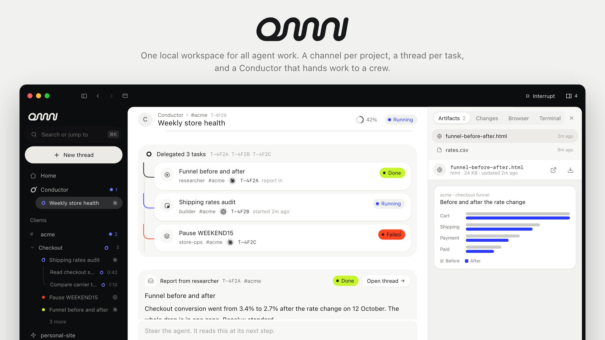

<p align="center">
  <picture>
    <source media="(prefers-color-scheme: dark)" srcset="docs/assets/hero/hero-dark.png">
    
  </picture>
</p>

# Omni OS

One local workspace for all agent work. Channels per client or project, a thread per task, a Conductor that hands work to a crew, and automations on a schedule or on GitHub PR events. Replaces hopping between Claude Desktop, Cursor cloud agents and a separate conductor bot.

One Node server on your Mac runs everything (threads, harnesses, database, secrets, automations). Two clients sit on top of its `/api` and show the same channels and threads:

| Client | What | Where |
| --- | --- | --- |
| Mac app | Native SwiftUI app for the desk. Starts and stops the server itself | `apps/mac/` |
| Web UI | React app, in any browser and on your phone over Tailscale | `apps/web/` |

## What does it cost?

Nothing extra. Omni runs each thread through the official CLI of the harness you pick, signed in to the plan you already pay for. It does not need an API key, except for the optional Hermes and Cursor Cloud harnesses.

## Harnesses

> [!IMPORTANT]
> Install and sign in to at least one harness before your first thread. [Auto](docs/user/harnesses.md#auto) is the default for new threads and picks the harness, model and effort from the first prompt, unless you set a default or pick one. Some features (published artifacts, mods) work only with Claude Code.
>
> - Claude Code (Claude plan): `npm install -g @anthropic-ai/claude-code`, then run `claude` and `/login`
> - Codex (ChatGPT plan): `npm install -g @openai/codex && codex login`
> - Cursor Agent (Cursor plan): `curl https://cursor.com/install -fsS | bash && cursor-agent login`
> - Hermes (Anthropic API, on your own Linux server): no CLI on the Mac. See [Harnesses](docs/user/harnesses.md#hermes-remote)
> - Cursor Cloud (Cursor plan, a Cursor cloud agent on Cursor's machines): the secret `CURSOR_API_KEY`. See [Harnesses](docs/user/harnesses.md#cursor-cloud)

`npm run setup` and the first-run screens check which ones are installed and signed in, and print the fix for each one that is not.

## Quick start

Needs macOS, Node 24+, `gh` signed in, and Xcode for the Mac app. The server and Web UI also run on Linux, without the Mac app; secrets go to a 0600 file there instead of the Keychain.

**Let an agent do it.** Open Claude Code, Codex or Cursor in an empty terminal and paste this. Swap `<you>` for your GitHub owner, or point it at an existing clone.

```text
Clone github.com/<you>/omni-os to ~/omni-os (skip if it is already there), then install and run its
Mac app. Follow the "Agent instructions" in docs/user/install.md step by step, run every check it
lists, and stop and tell me if a check fails. Ask me before running `npm run setup` without --yes,
since it asks who I am.
```

**Or by hand:**

```bash
git clone https://github.com/<you>/omni-os.git ~/omni-os
cd ~/omni-os
npm install --include=dev
npm run setup          # who you are and where your work lives; Enter takes each default
scripts/build-mac.sh   # Mac app: builds, installs to ~/Applications/Omni.app and opens it
npm run dev            # or the Web UI: server on :4747, UI on http://localhost:4748
```

Forking it for yourself? Read [FORKING.md](FORKING.md): everything personal lives in `data/`, so upstream updates merge cleanly.

> [!WARNING]
> Omni is early and built for one person's daily use on their own Mac. Expect rough edges.
>
> - Threads run with `bypassPermissions`, since nobody can answer a prompt headless. Isolation is a git worktree plus a browser profile, not a VM.
> - Every API request needs the install's token from `data/api-token`. A browser pairs once to get it. Keep the server on loopback and reach it remotely only over your tailnet. See [Remote access and security](docs/user/remote-access.md).

## What you get

- **Channels** per client or project, each with its own icon, default harness, model and effort, a design system file for the agent, and facts like the repo, Shopify store and Portal slug
- **Threads** per task, dated, full-text searchable and resumable. Running and Pinned keep work reachable across channels; Mark done clears a thread from Needs you until something new happens. Steer, queue or interrupt while one runs, or pick a model or harness for its next turn
- **Composer**: `/` menu for skills, slash commands and MCP prompts per harness, `@` to mention artifacts and repo files, attachments, and chips for diff lines, terminal output, browser annotations and other threads, plus suggested next replies
- **Sandbox per thread**: its own git worktree in repo channels, a choice of base commit, channel setup and named actions, a persistent browser shown live in the Browser panel, a real terminal, and secrets from the Keychain (or a 0600 file on Linux) as env. Hermes and Cursor Cloud run remotely without these local tools
- **Artifacts** rendered inline, an Artifacts page across channels, and cards for pages a thread published to claude.ai
- **GitHub panel** per repo channel: PRs, checks, diff and merge. Watch PR wakes the thread for failing checks or new review feedback
- **Conductor and crew**: one front agent that delegates to roles (builder, researcher, store-ops, inbox), alone or as a team
- **Automations**: YAML on a cron schedule, GitHub PR event, published page or signed GitHub webhook; every run is its own thread
- **Sync** between two Macs through a Supabase project you own (optional), with handoff of a running thread to the other Mac
- **Phone layout** with Activity, Channels and Library tabs, a new-thread sheet and full-screen thread panels. Save it to the iPhone home screen over Tailscale

## Documentation

Start at [docs/](docs/README.md). The most used pages:

- [Install and first run](docs/user/install.md), including the agent instructions
- [Your config, `.env` and secrets](docs/user/configuration.md)
- [Threads: Needs you, sending, context chips and Watch PR](docs/user/threads.md)
- [Harnesses](docs/user/harnesses.md) · [Crew and Conductor](docs/user/crew.md) · [Automations](docs/user/automations.md)
- [Sync between two Macs](docs/user/sync.md), with the one-time Supabase setup
- [Remote access and security](docs/user/remote-access.md)
- [Known limits](docs/user/limits.md)

Working on Omni itself? Read [CONTRIBUTING.md](CONTRIBUTING.md), then the [architecture overview](docs/internals/overview.md). Domain words (channel, thread, turn, crew role) are defined in [CONTEXT.md](CONTEXT.md).
