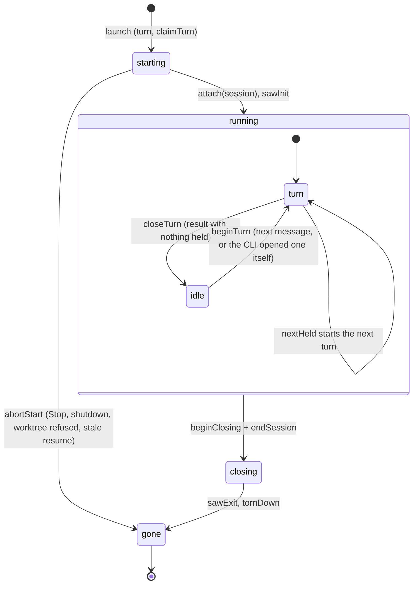
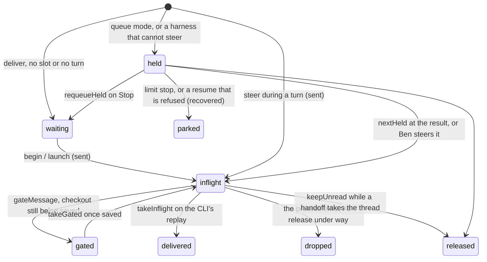
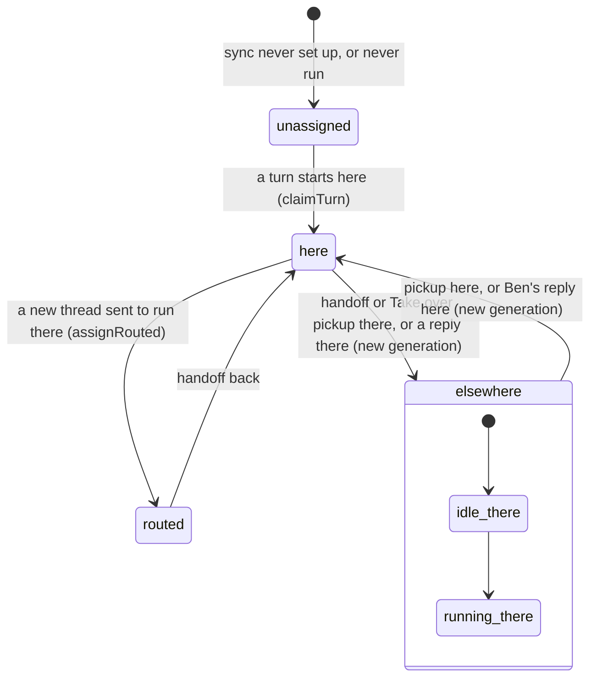

# Execution and ownership state

How a thread runs on one machine, who owns that state, and how the runner reaches the rest of Omni. Start here before
touching `apps/server/runner/`. The words (thread, turn, request, delivery state) are in [GLOSSARY.md](../../GLOSSARY.md);
who may run a thread at all is [ADR 0005](../adr/0005-one-execution-owner.md), and what a message is promised is the
[delivery contract](delivery.md).

## Who owns what

| State | Owner | Where |
| --- | --- | --- |
| A thread's process: its session, turn, held and inflight messages, timers, tasks, mods | its `ThreadController` | `runner/controller.ts` |
| Which threads wait for a slot, and with what messages | the scheduler | `runner/state.ts` (`waiting`, `waitingMsgs`), moved by `runner/queue.ts` |
| Which machine holds a thread, on which generation | the assignment row | `db/repos/assignments.ts`, read through `ownership.ts` |
| A message's delivery state | its request row | `db/repos/requests.ts`, moved by `runner/state.ts track` |
| Where a thread runs when not here | routing | `run-on.ts` |
| A thread on its way between Macs | the handoff records | `handoff.ts`, `handoff/records.ts` |
| A change to a thread's run or machine, or a Continue, as something asked, read and cancelled by id | the transition service | `transition.ts`, `transitions-api.ts`, ledger in `db/repos/transitions.ts` ([transitions](transitions.md)) |

Every other runner module sees a process as `Live`: the controller with every field read-only. A module changes that
state only through the controller's methods, and each method is one arrow in the diagrams below. A write anywhere else
fails `npm run typecheck`.
`runner/spawn.ts launch` builds the controller with the deps `apps/server/compose.ts` bound: reporting (the transcript
row and the thread feed), scheduling (timers) and persistence (the status write that claims a turn). A test builds one
with fakes (`tests/thread-controller.test.ts`).

## Several agents in one thread

A group thread ([ADR 0019](../adr/0019-group-threads.md)) runs one session per agent. Each member's session lives in a hidden thread row of its own (`source: 'member'`, `parent_id` the group thread, `role` the agent, the same cwd and branch), so the controller, spawn, limits and questions above work per member unchanged. The `thread_members` table (`db/repos/members.ts`) lists who sits where: one row per agent, with its session thread, the lead flag and its cursor (the last transcript row it read). It syncs as the signed `thread_member` entity (`sync/handlers/thread-member.ts`).

- **One transcript.** `events.add` writes a member thread's rows into the group thread with `agent` set to the member, and the runner's own reads (`scopeOf`, `transcriptOf` in `db/repos/events.ts`) see only that agent's rows. The thread feed shows a member thread's updates as the group thread's (`setShownThread`).
- **Routing.** `runner/members.ts` starts every agent a message names at once, in the thread's one worktree: a round kept in memory per message, settled agent by agent by the `turnEnded` hook each turn end fires (`state.ts endedTurn`). Each member session is a thread row of its own, so each turn takes a slot from its own harness's cap (`runningByHarness`, `capFor`) and the rest queue; the group thread has no cap of its own. An agent already at work hears the message as a steer through `deliver`. A parent gets its report when the lead's turn ends, even while members still run. The follow-up suggestion comes from the lead's reply when it answered, else from the last agent to finish.
- **One checkpoint per message.** A round opens one turn snapshot for the whole message (`startMessageSnapshot` in `runner/snapshots.ts`) and closes it when the last named agent settles. While it is open, the per-turn snapshot is skipped for the group thread, and a member session never takes one.
- **Collisions.** `runner/collisions.ts` watches each edit call (`Edit`, `MultiEdit`, `Write`, `NotebookEdit`, `Delete`; Codex and Cursor Agent map theirs onto these) through the `toolUsed` hook. A busy period opens with a group thread's first working agent and ends when none works. A file two agents both edit in one busy period gets a `collision` row with its own `key`, the agents and HEAD, and each agent that edited it is told the other's files: a steer into a running Claude Code or Codex turn, else a line at the top of its next turn (a hidden `notice` message). Shell writes are not counted. At every turn end in the thread, a flag whose HEAD has moved gets a `collision_cleared` row (`by: 'commit'`); Ben's Dismiss (`POST /api/threads/<id>/collisions/<event>/dismiss`, refused for agent callers) writes one with `by: 'dismiss'`. Clearing rows name flags by key, since row ids are each machine's own, so flags and clearings sync with the transcript. Changes and `get_thread` read the flags with `collisionsOf`.
- **Commits.** Only the lead commits, pushes or opens a PR. A member's prompt says so, and a Claude Code member runs with `MEMBER_DENIED` (`crew.ts`) in its disallowed tools. That list is a coordination guard, not a security boundary.
- **Stop.** `interruptThread` stops every seated member's session, then the lead's. A message that names no agent steers only the lead.
- **Remote members.** A member on a remote harness (Cursor Cloud, Hermes, a custom harness) edits nothing in the worktree and takes no part in collisions. A Cursor Cloud member works on its own branch with no PR (`autoCreatePR` off). When its turn ends, Omni writes a message to the lead asking it to pull that branch into the thread's branch, which starts a lead turn.
- **Removal.** A member removed mid-turn is marked leaving: its turn finishes, its waiting and held messages drop, and the left line and session close follow.
- **Moving.** Handoff, Take over, Fork and Continue are refused while `busyAgents` names an agent still working, then move every member session with the thread.

## A process

There is one per thread while the thread is warm. `[*]` on the left is `launch`; on the right the controller is forgotten (`teardown`).

Why a process starts closing, and what the end looks like (`endSession`):

| Cause | How | Then |
| --- | --- | --- |
| Stop, or an interrupt the CLI did not take in time | `stop`: SIGINT, kill after 5s | the turn ends `stopped`; held messages wait for the next process |
| Idle past the keepalive, or a switch, a fresh context, a stale generation | `close`: stdin ends, terminate after 10s | the thread keeps its status; the next message starts a new process |
| Omni shutting down | `shutdown`: stdin ends, terminate 3s, kill 5s | a running turn is marked failed with an error row; durable messages park for Resume |

`armIdle` schedules the close after `OMNI_KEEPALIVE_SECONDS`, or `OMNI_TASK_KEEPALIVE_SECONDS` while a background task
keeps the process alive. `armInterrupt` holds the interrupt id until the CLI's control reply (`ackInterrupt`) or the grace
timer (`hardKill`).

## A message inside a process

Where a message sent to a thread can be, and the request state recorded for it (`GLOSSARY.md`, Delivery state).

## Ownership between machines

The assignment says which machine holds the thread; the process remembers the generation it started its turn on.

- A process here whose generation is behind the assignment is stale: `deliver` gives it nothing more, and `fenceStale`
  after each sync stops its turn with an error row, or closes it when idle.
- Messages, Stop and limit actions for a `routed`, delegated or worktree thread go to its holder as remote commands (`run-on.ts`);
  a wake for a thread held elsewhere parks for Resume (`sync/guard.ts wakeBlocked`, applied in `runner/queue.ts wake`).

## How the runner reaches the rest of Omni

The runner's files import none of `run-on.ts`, `handoff.ts`, `published.ts` or the automations; those import the runner.
What the runner needs from them is a port in `runner/ports.ts`, and `apps/server/compose.ts`, the one composition root,
binds each to its module and builds the controller deps:

| Port | Bound to | Used by |
| --- | --- | --- |
| `routing.targetFor`, `forwardMessage` | `run-on.ts` | `runner/api.ts` createThread, postMessage |
| `routing.forwardReport` | `run-on.ts` | `runner/queue.ts` reportToParent |
| `handoff.sendNewThread` | `handoff.ts` | `runner/api.ts` createThread for another machine |
| `reporting.toolResult` | `published.ts`, then `automation-triggers.ts` | `runner/records.ts` on every tool result |
| `reporting.quietRun` | `automation-quiet.ts` | `runner/session.ts` as a turn ends, before its alert |

`app.ts` and the test boot (`tests/runner-boot.ts`) import `compose.ts` first; a port used before that throws an error that names it.
`tests/import-boundaries.test.ts` scans the runtime imports and fails on any cycle that crosses an owner, so a new import
that breaks the rules above fails the test.
