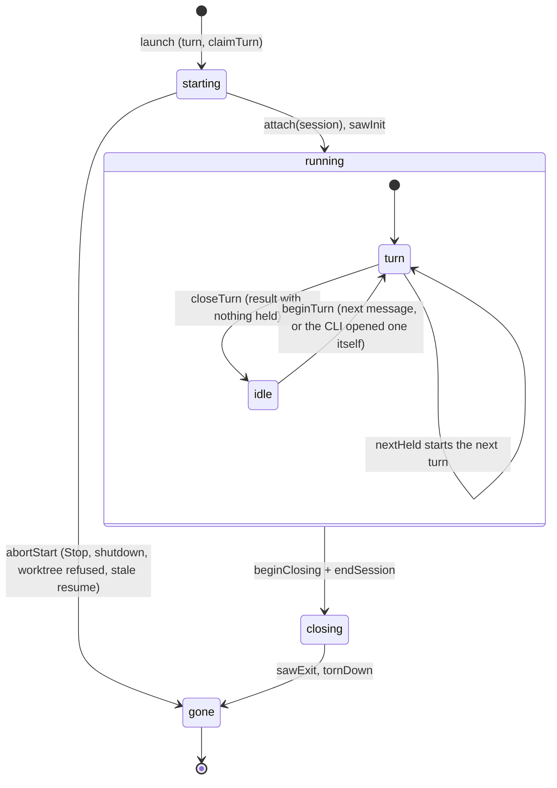
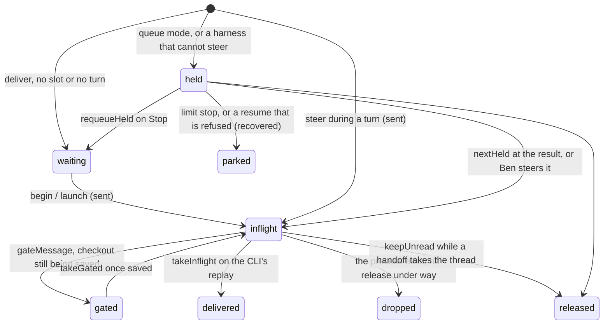
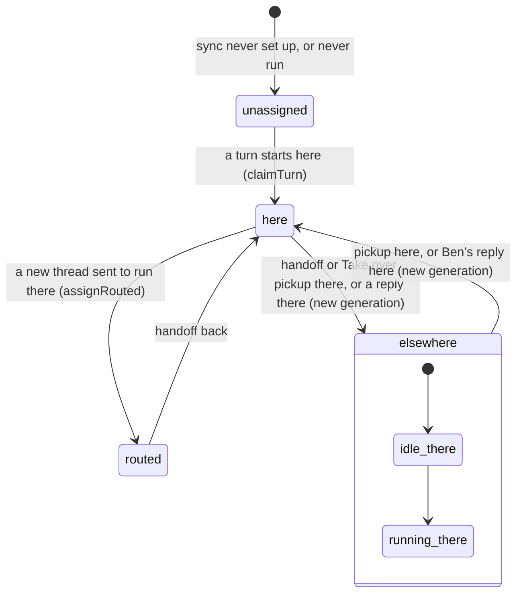

# Execution and ownership state

How a thread runs on one machine, who owns that state, and how the runner reaches the rest of Omni. Start here before
touching `apps/server/runner/`. The words (thread, turn, request, delivery state) are in [CONTEXT.md](../../CONTEXT.md);
who may run a thread at all is [ADR 0005](../adr/0005-one-execution-owner.md), and what a message is promised is the
[delivery contract](delivery.md).

## Who owns what

| State | Owner | Where |
| --- | --- | --- |
| A thread's process: its session, turn, held and inflight messages, timers, tasks, mods | its `ThreadController` | `runner/controller.ts` |
| Which threads wait for a slot, and with what messages | the scheduler | `runner/state.ts` (`waiting`, `waitingMsgs`), moved by `runner/queue.ts` |
| Which machine holds a thread, on which generation | the assignment row | `db/repos/assignments.ts`, read through `ownership.ts` |
| A message's delivery state | its request row | `db/repos/requests.ts`, moved by `runner/state.ts track` |
| Where a thread runs when not here | routing | `run-on.ts` |
| A thread on its way between Macs | the handoff records | `handoff.ts`, `handoff/records.ts` |

Every other runner module sees a process as `Live`: the controller with every field read-only. It moves the state
only through the controller's methods, each one arrow below, so `npm run typecheck` fails on a write anywhere else.
`runner/spawn.ts launch` builds the controller with the deps `apps/server/compose.ts` bound: reporting (the transcript
row and the thread feed), scheduling (timers) and persistence (the status write that claims a turn). A test builds one
with fakes (`tests/thread-controller.test.ts`).

## A process

One per thread while it is warm. `[*]` on the left is `launch`; on the right the controller is forgotten (`teardown`).

Why a process starts closing, and what the end looks like (`endSession`):

| Cause | How | Then |
| --- | --- | --- |
| Stop, or an interrupt the CLI did not take in time | `stop`: SIGINT, kill after 5s | the turn ends `stopped`; held messages wait for the next process |
| Idle past the keepalive, or a switch, a fresh context, a stale generation | `close`: stdin ends, terminate after 10s | the thread keeps its status; the next message starts a new process |
| Omni shutting down | `shutdown`: stdin ends, terminate 3s, kill 5s | a running turn is marked failed with an error row; durable messages park for Resume |

`armIdle` schedules the close after `OMNI_KEEPALIVE_SECONDS`, or `OMNI_TASK_KEEPALIVE_SECONDS` while a background task
keeps the process alive. `armInterrupt` holds the interrupt id until the CLI's control reply (`ackInterrupt`) or the grace
timer (`hardKill`).

## A message inside a process

Where a message sent to a thread can be, and the request state recorded for it (`CONTEXT.md`, Delivery state).

## Ownership between machines

The assignment says which machine holds the thread; the process remembers the generation it started its turn on.

- A process here whose generation is behind the assignment is stale: `deliver` gives it nothing more, and `fenceStale`
  after each sync stops its turn with an error row, or closes it when idle.
- Messages, Stop and limit actions for a `routed` or delegated thread go to its holder as remote commands (`run-on.ts`);
  a wake for a thread held elsewhere parks for Resume (`sync/guard.ts wakeBlocked`, applied in `runner/queue.ts wake`).

## How the runner reaches the rest of Omni

The runner's files import none of `run-on.ts`, `handoff.ts`, `published.ts` or the automations; those import the runner.
What the runner needs from them is a port in `runner/ports.ts`, and `apps/server/compose.ts`, the one composition root,
binds each to its module and builds the controller deps:

| Port | Bound to | Used by |
| --- | --- | --- |
| `routing.targetFor`, `forwardMessage` | `run-on.ts` | `runner/api.ts` createThread, postMessage |
| `routing.forwardReport` | `run-on.ts` | `runner/queue.ts` reportToParent |
| `handoff.sendNewThread` | `handoff.ts` | `runner/api.ts` createThread for another machine |
| `reporting.toolResult` | `published.ts`, then `automation-triggers.ts` | `runner/records.ts` on every tool result |

`app.ts` and the test boot (`tests/runner-boot.ts`) import `compose.ts` first; a port used before that throws naming it.
`tests/import-boundaries.test.ts` scans the runtime imports and fails on any cycle that crosses an owner, so the lines
above hold without anyone watching them.
